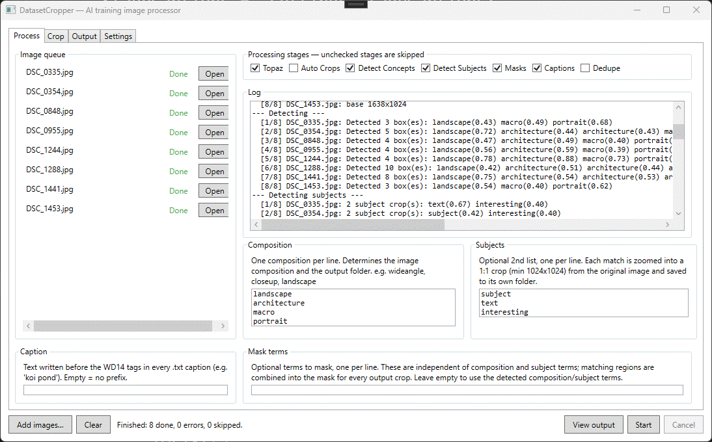
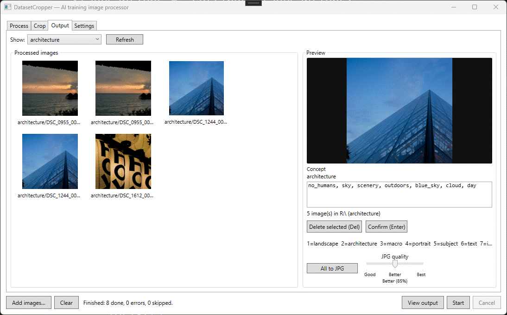
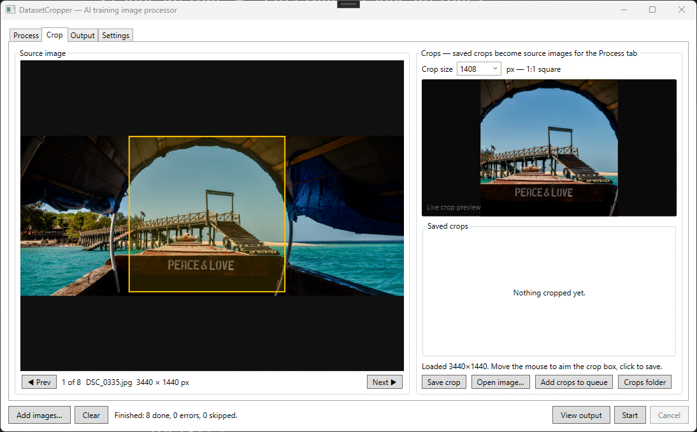

# DatasetCropper

DatasetCropper is a Windows desktop batch processor for preparing AI-training image datasets. It is designed to process images into datasets creating overlapping 1024x1024 tiles and concept-centered crops.

## Features
- Batch process images into overlapping 1024x1024 tiles
- Detect whole image composition and assign
- Detect concepts within image and crop to concept, uses Grounding DINO or YOLO
- Generate masks with SAM, CLIPSeg, or Rembg
- Caption with WD14 tags or ViT-GPT2
- Upscale with Topaz if you have it
- Detect duplicates
- Quickly make manual 1x1 crops when processing fails

## Screenshots

| Process queue | Output review | Manual crop |
| --- | --- | --- |
|  |  |  |

## Install (Windows x64)

1. Download `DatasetCropper-win-x64.zip` from the [latest GitHub release](https://github.com/simonjlawson/Tagger/releases/latest).
2. Extract the ZIP to a folder where you want to keep the app, such as `C:\Apps\DatasetCropper`.
3. Run `DatasetCropper.exe` from that folder. The release includes the .NET runtime; no separate runtime installation is needed.
4. Add images, choose concepts and an output folder, then select **Start**. If model files are missing, the app offers to download them; model downloads can require several gigabytes and an internet connection.

Settings and downloaded models are stored under `%APPDATA%\DatasetCropper`, separately from the app folder, so replacing the extracted app with a newer release keeps them. To update, close the app, extract the new release over the existing folder, and run `DatasetCropper.exe` again.

## Build from source

Requires the .NET 10 SDK and Windows. ImageSharp requires a SixLabors license key; set the `SixLaborsLicenseKey` environment variable before building. From the repository root:

```powershell
dotnet build DatasetCropper.sln
dotnet run --project src/DatasetCropper
dotnet test tests/DatasetCropper.Tests
```

## Publishing a release

Add a `SIXLABORS_LICENSE_KEY` Actions secret in the repository settings before the first release. Then push a new version tag such as `v1.2.0`:

```powershell
git tag v1.2.0
git push origin v1.2.0
```

The Windows release workflow runs the test suite, publishes a self-contained `win-x64` app, and creates a GitHub Release with `DatasetCropper-win-x64.zip` and generated release notes. Use a new `v`-prefixed version tag for each release.
